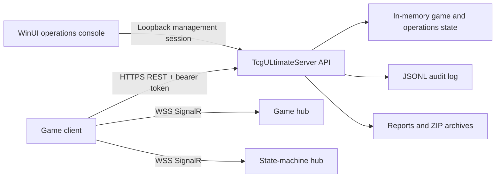

# TcgULtimateServer documentation

This documentation covers the native WinUI operations console, the .NET 8 server, player-client connections, real-time communication, security, and every currently implemented management feature.

## Start here

| Audience | Recommended guide |
|---|---|
| Server operator | [Getting started](getting-started.md) |
| Game client developer | [Connection tutorials](connection-tutorials.md) |
| Unity client developer | [Unity client tutorial](unity-client-tutorial.md) |
| Unity project starter | [Unity project template](../templates/TcgUnityClient/README.md) |
| Product and release planning | [Unity client product roadmap](unity-client-roadmap.md) |
| Network or backend developer | [Communications protocol](communications-protocol.md) |
| API integrator | [API reference](api-reference.md) |
| Security or deployment owner | [Security and deployment](security-and-deployment.md) |
| WinUI administrator | [Feature documentation](features/README.md) |
| Rules and content designer | [Rules and visual content studio](features/rules-and-content-studio.md) |

## System map

## Documentation set

- [Getting started](getting-started.md) - requirements, launch options, health checks, configuration, and data lifecycle.
- [Connection tutorials](connection-tutorials.md) - player authentication, REST calls, matchmaking, game creation, SignalR, and Unity/.NET examples.
- [Unity client tutorial](unity-client-tutorial.md) - Unity project layout, coroutine REST client, session handling, matchmaking, SignalR, secure packets, and scene integration.
- [Unity client product roadmap](unity-client-roadmap.md) - complete phased features, architecture backlog, acceptance gates, and definition of done.
- [Communications protocol](communications-protocol.md) - transport rules, bearer sessions, secure packets, hub methods, server events, compression, limits, and error handling.
- [API reference](api-reference.md) - all REST endpoints grouped by purpose and access level.
- [Security and deployment](security-and-deployment.md) - roles, local management access, TLS, secrets, audit retention, reverse-proxy guidance, and production checklist.
- [Feature documentation](features/README.md) - the complete WinUI management feature catalog and detailed module guides.
- [Rules and visual content studio](features/rules-and-content-studio.md) - system-neutral rules schema, visual editor, validation, publishing, imports, exports, and content upload workflows.

## Product boundaries

- The WinUI console does not require an operator login. It receives a server-issued, loopback-only local management session.
- Player and game-client sign-in is enforced by the server.
- The server root returns `404` intentionally. Use `/api/health`, REST routes under `/api`, and SignalR hubs under `/hubs`.
- Gameplay and most operations state is currently held in memory. Export archives before planned shutdowns when the data must be retained.
- Items explicitly marked **Roadmap** in the feature guides are visible in the management map but are not represented as live controls.
